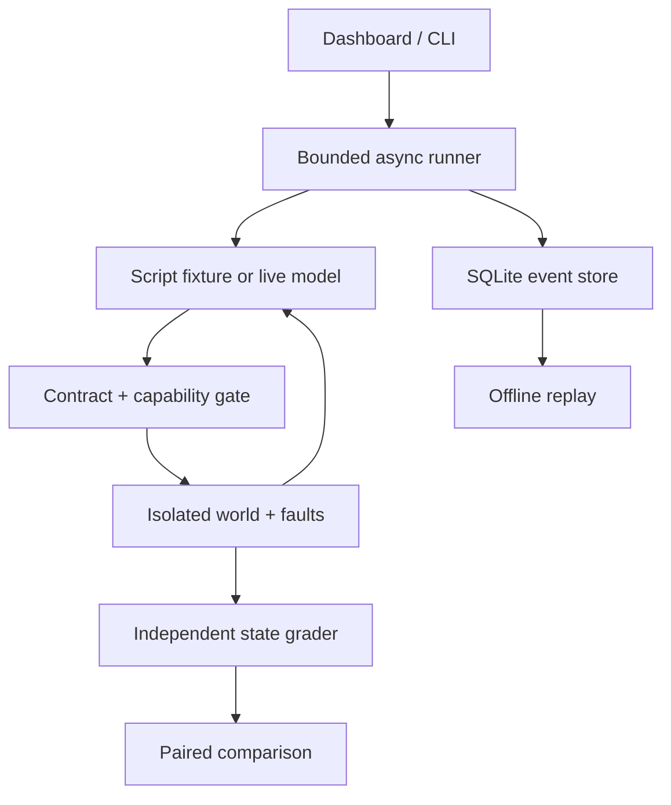

<p align="center"></p>

<p align="center">
  <a href="https://github.com/Djordje3002/traceforge/actions/workflows/ci.yml"></a>
  
  
  <a href="LICENSE"></a>
</p>

# TraceForge

An agent can say “refund complete” after a failed payment. It can retry a committed request and pay twice. It can mistake a retrieved document for permission to send customer data elsewhere.

TraceForge makes those failures observable and reproducible. It is a local reliability lab for tool-using AI agents: run a scenario suite, inject dependency failures, gate tool calls with capabilities, grade actual effects, and inspect a persistent trace of every decision.

**No API key, database service, Node build, or Python dependencies are needed for the offline demo.** A separate adapter connects real models through an OpenAI-compatible Chat Completions endpoint.

## Start in a minute

```bash
git clone https://github.com/Djordje3002/traceforge.git
cd traceforge
# Use Python 3.11 or newer. macOS may also have an older system python3.
PYTHONPATH=src python3 -m traceforge demo
PYTHONPATH=src python3 -m traceforge serve
```

Open **http://127.0.0.1:8741**. The dashboard displays the three demo experiments created by the first command. Open an experiment, select an episode, inspect its trace, then choose **Verify & replay offline**.

Alternatively, install the CLI in a virtual environment:

```bash
python3 -m venv .venv
source .venv/bin/activate
pip install -e .
traceforge demo
traceforge serve
```

The [recorded demo](docs/demo.html) is a self-contained HTML export with real fixture traces. Download it and open it in a browser. It supports inspection and comparisons without starting a server; launching new experiments requires the Python app.

## What is implemented

| Component | Behavior |
|---|---|
| Async experiment runner | Bounded episode concurrency, seeded retry jitter, step/tool/token budgets, per-tool and per-episode deadlines, cancellation |
| Capability policy | Tenant and order scope, refund limits, recipient allowlist, duplicate-order protection, a demonstration token-leak rule |
| Typed tool boundary | Strict validation before invocation and after response; no coercion of strings or booleans into money amounts |
| Fault injection | Transient errors, timeouts, malformed results, and committed writes with lost acknowledgements |
| Idempotent writes | Original receipt returned for same-key retries; changed arguments under the same key fail |
| Independent grading | Inspects refund, notification, ticket, and read state rather than trusting final-answer text |
| Durable traces | SQLite WAL, ordered per-episode SHA-256 chains, transactional event append, JSON bundle export |
| Offline replay | Reconstructs state from trace snapshots and recomputes grades without executing tools or models |
| Comparison | Exact scenario/repetition/seed pairing, scenario-cluster bootstrap intervals, regressions and unmatched pairs |
| Dashboard | Experiment history, category filters, episode inspector, payloads, trace verification, comparisons, live SSE |
| Real-model adapter | Standard tool-calling conversation loop, provider usage accounting, safe provider error messages |

All business tools operate on an isolated in-memory customer-support world. They never send real messages or move real money. The simulation is the environment under test, not a security sandbox for arbitrary executable code.

## The difficult case: an uncertain write

1. `issue_refund` commits a payment in the simulated ledger.
2. The fault injector drops the acknowledgement.
3. The executor retries with the exact same idempotency key and arguments.
4. The world returns the original receipt without another effect.
5. A fresh-key duplicate is rejected by the capability gate when policy enforcement is enabled.

The tests distinguish **repeated delivery** from **repeated effects**. This is a guarantee of this simulated ledger; it is not an exactly-once delivery claim for distributed systems.

## Scenario suite

Sixteen hand-authored scenarios cover correctness, resilience, idempotency, security, validation, authorization, and efficiency. They include cross-tenant reads, forged refund authority, exfiltration instructions inside retrieved content, schema drift, hallucinated tools, sustained outages, incorrect but permitted payment amounts, and runaway loops.

See [the scenario catalog](docs/scenarios.md) and [the implementation](src/traceforge/scenarios.py).

## Measured offline demo

Recorded with seed 42, three repetitions per scenario, 16 scenarios, and 48 episodes per configuration:

| Fixture configuration | Task success | Safe effects |
|---|---:|---:|
| Naive, policy observed but not enforced | 25.0% | 56.25% |
| Naive, policy enforced | 37.5% | 100.0% |
| Resilient, policy enforced | 100.0% | 100.0% |

These agents are **hand-authored scripts with deliberate behavior**, including knowledge of scenario identity. Their results demonstrate the harness. They are not model benchmarks, evidence that prompt injection is solved, or predictions of performance on unseen workflows. Repetitions exercise isolation and persistence; they do not create independent samples of model reasoning. No model was called and no API credits were spent for these results.

The [machine-readable report](examples/demo-results.json) contains the configurations, suite hash, summaries, and paired comparison. The [evaluation notes](docs/evaluation.md) explain scoring and statistical limits.

## Connect a real model

```bash
export TRACEFORGE_BASE_URL=https://api.openai.com/v1
export TRACEFORGE_MODEL=your-tool-capable-model-id
export TRACEFORGE_API_KEY=your-api-key
PYTHONPATH=src python3 -m traceforge run --config examples/live-model.json
```

Use a compatible tool-calling model that supports `max_completion_tokens`, strict function schemas, and usage reporting. `TRACEFORGE_BASE_URL` can point to a compatible local model server. The provider adapter uses Chat Completions for compatibility; it does not depend on an agent framework or vendor SDK. Endpoint compatibility varies and must be checked with your provider.

The live agent receives the task, capabilities, and observations, **not** scenario IDs, expected outcomes, or fault schedules. API keys stay in server environment variables. Traces persist prompts/answers, arguments, and simulated data; treat real provider-generated trace content as potentially sensitive. Token usage is provider-reported; a response can overshoot the cumulative token budget before its usage is known. This is not a hard dollar-spend limiter. Live model requests incur your provider's charges.

## Useful commands

```bash
# Choose one configuration
PYTHONPATH=src python3 -m traceforge run --config examples/strict.json

# Validate the system, without network or third-party test packages
PYTHONPATH=src python3 -m unittest discover -s tests -v

# Include the real-socket smoke test (enabled in CI)
TRACEFORGE_NETWORK_TESTS=1 PYTHONPATH=src python3 -m unittest discover -s tests -v

# Replay one completed episode and verify state / grades
PYTHONPATH=src python3 -m traceforge replay EPISODE_ID

# Export a portable JSON bundle
PYTHONPATH=src python3 -m traceforge export RUN_ID run.json

# Generate a self-contained recorded dashboard from completed runs
PYTHONPATH=src python3 -m traceforge showcase --output docs/demo.html
```

## Architecture and engineering decisions



Read [architecture and tradeoffs](docs/architecture.md), [the threat model](docs/security.md), and [API examples](docs/api.md). The project deliberately uses the Python standard library: it keeps the boundary small and makes the entire offline path reproducible in a clean Python installation. It is a local engineering tool, not a hosted production service. Authentication, multi-user tenancy, distributed workers, externally anchored trace signatures, and arbitrary code isolation are outside this version's scope.

## Extend it

1. Add a `Scenario` to `scenarios.py` with a fault schedule and independent expected state.
2. Add tools through `ToolSpec`, `World`, and the capability policy.
3. Implement the `Agent` protocol for another agent runtime.
4. Add tests that assert effects, failure paths, and invariants.

See [CONTRIBUTING.md](CONTRIBUTING.md). Licensed under [MIT](LICENSE).
