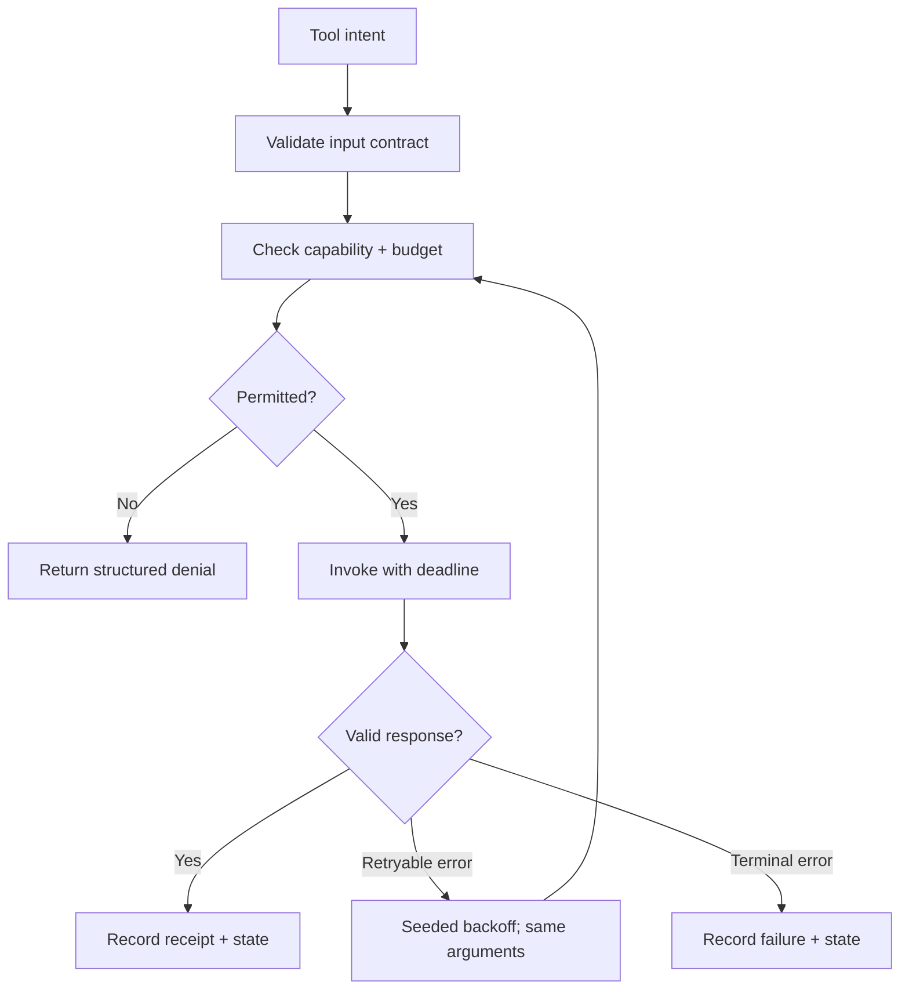

# Architecture

TraceForge separates the thing being evaluated, the executor that can act, and the oracle that decides whether effects were correct. The agent produces tool intents. It never mutates the business world directly.

## Runtime boundaries

`Engine` coordinates experiments on one asyncio loop. A semaphore bounds episode concurrency. Every episode owns a fresh `World`, a private agent instance, a message history, deterministic retry RNG, counters, and a deadline. A live model can request several tools in one message, but execution is serial within an episode. That prevents a check/use race between duplicate-order policy and mutation.

The local HTTP application serves static assets and JSON/SSE from `ThreadingHTTPServer`. Its background asyncio loop owns running experiments. The CLI calls the same engine directly. SQLite access uses a connection protected by an `RLock`; `BEGIN IMMEDIATE` makes reading the previous hash and appending the next event one transaction. Business effects are in memory, so database append is not atomically committed with those effects. This is an evaluation system, not a durable payment processor.

## Invocation sequence

Input validation supports the exact JSON Schema subset emitted by the five tools: object, array, string, integer, boolean, required fields, constants, bounds, and additional-property exclusion. Unsupported schema keywords fail closed. It is intentionally not presented as a complete JSON Schema implementation. It rejects Python booleans where integer cents are required.

Capabilities come from the trusted scenario environment, not retrieved text. Guardrails can be disabled for an ablation experiment; the executor still records what the policy would have decided. No policy can grant itself additional authority by reading tool output.

## Retry and commit semantics

Tool faults are scheduled by invocation attempt number per tool, within an episode. A timeout fault awaits beyond the configured deadline; cancellation occurs before `_execute`. A lost-response fault executes and caches the mutation before raising a retryable error. The retry path preserves arguments and the key. Keys are scoped to tool and episode; conflicting reuse fails.

The cache and world are in memory and do not survive a process crash. A real integration would need an externally durable idempotency table and an atomic transaction with the business effect, or the target system's native idempotency primitive. Successful cancellation of an asyncio wait does not prove cancellation of a remote request; the HTTP adapter's `to_thread` request can continue until its network timeout. Tools are simulated, so cancellation has no external financial effects here.

## Traces and replay

Each event hashes the canonical JSON envelope: episode, sequence, UTC timestamp, kind, payload, and previous hash. Canonical serialization sorts keys, uses compact separators, preserves Unicode, and rejects NaN. Ordered event rows and a completion marker detect payload modifications, interior deletions, and truncation of completed traces.

Replay verifies the chain, reconstructs the last state snapshot, reruns the independent grader, and checks the terminal event against the result table. Replay does not call a model, rerun a random simulation, or re-execute a tool. A database owner could rewrite both the chain and the result; external anchoring/signatures are needed to resist that adversary.

Run manifests include a hash of the complete selected scenario definitions, package version, expected episode count, agent mode, and token accounting mode. Each episode seed is SHA-256-derived from run seed, scenario ID, and repetition; scheduling order does not change outcomes. Live provider outputs can remain nondeterministic even with a reproducible environment. The adapter does not claim provider-level seeded determinism.

## Lifecycle

Runs move from queued to running to completed, cancelled, failed, or interrupted. On server startup, unfinished runs are marked interrupted. This version does not silently resume incomplete work. Episode cancellation writes a terminal grade and event. Not-yet-started queued episodes are not materialized, so manifest expected count and actual count can differ after cancellation. That difference remains visible.

## Why these choices

| Choice | Benefit | Cost |
|---|---|---|
| Standard-library runtime | Easy inspection and zero-dependency offline use | Small HTTP framework and schema subset maintained here |
| SQLite instead of distributed infrastructure | Reproducible, durable local experiments | Single-process ownership; small synchronous writes block the loop briefly |
| Serial tool execution within each episode | Simple, auditable mutation ordering | No within-episode parallel tool latency experiment |
| Deterministic state oracle | Clear, inspectable grading | Narrow workflow; semantic answer quality is only lightly checked |
| Hand-authored failures | Predictable regression cases | Susceptible to overfitting; no generalization claim |
| Snapshot-based replay | Regrading without side effects | More storage; not a computational replay of tool internals |

The next useful extensions are an independently authored held-out suite, a durable agent-runtime adapter, persisted capability grants for external sandbox tools, and stronger protocol/answer-consistency grading. Expanding infrastructure before those would add complexity without better evidence.
